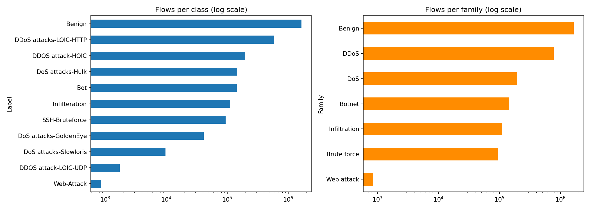
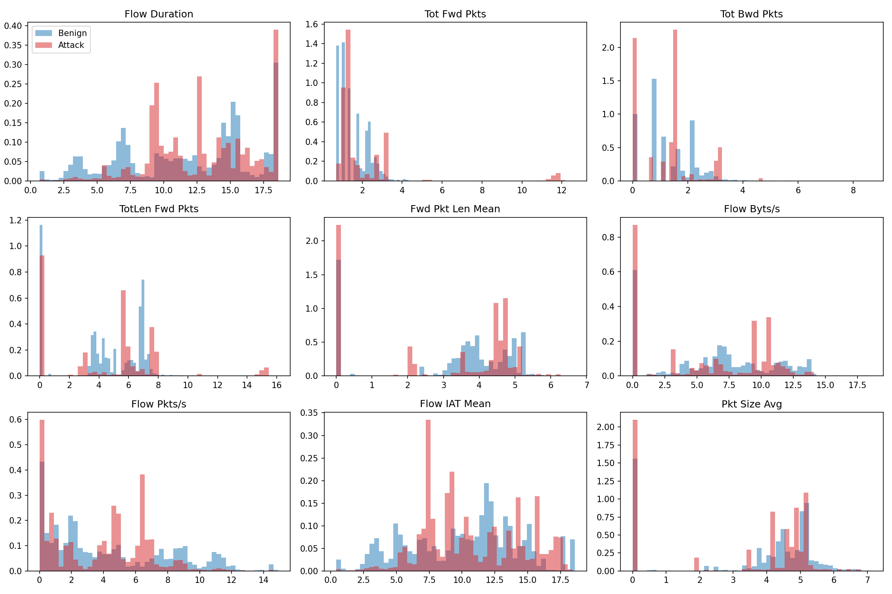
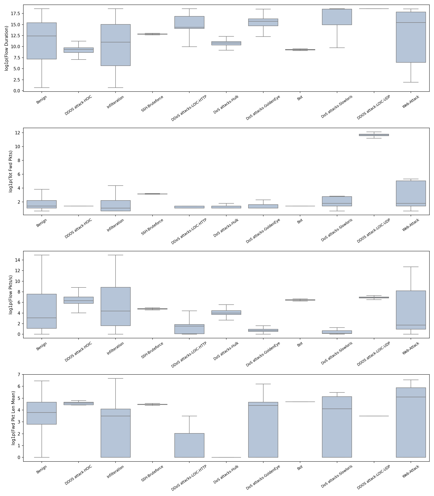
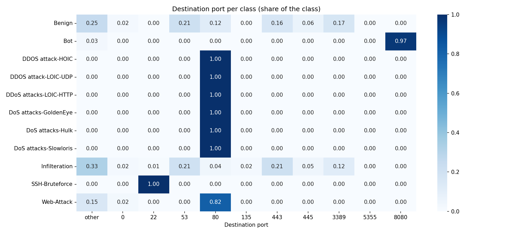
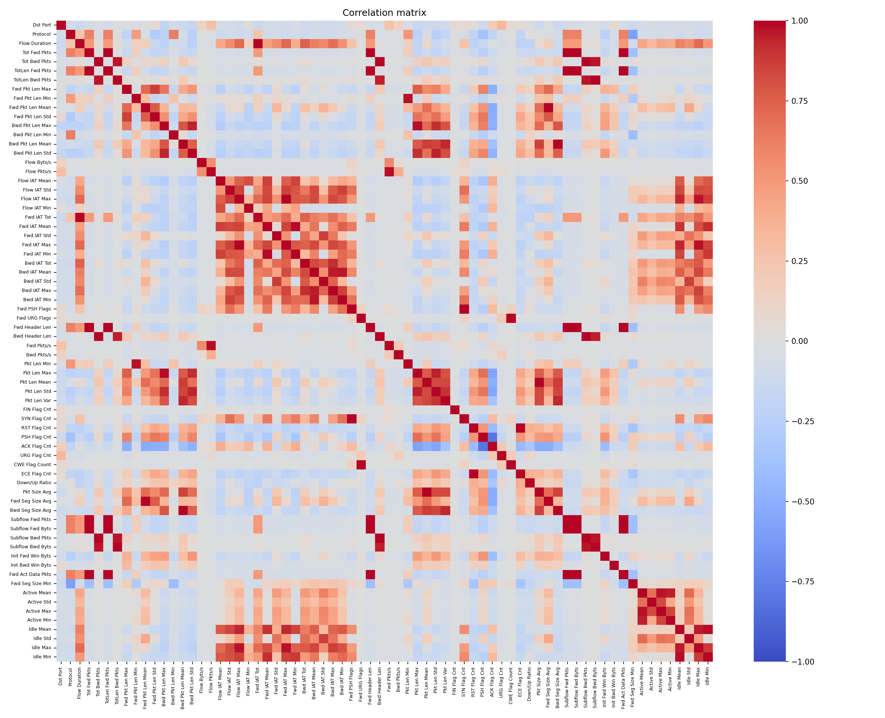
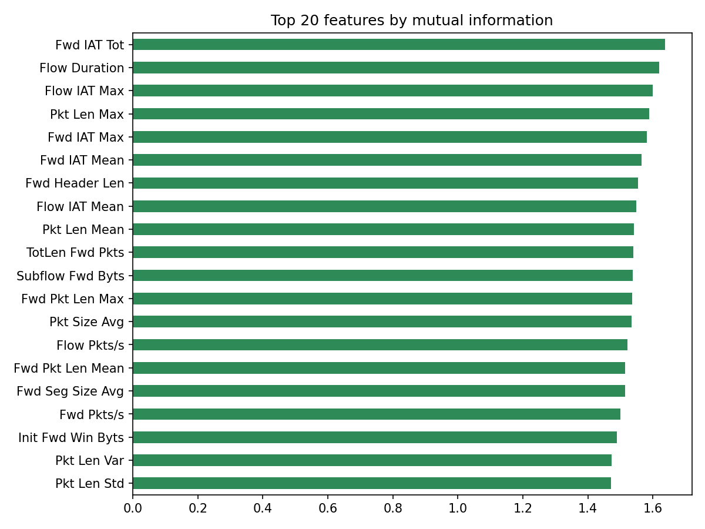
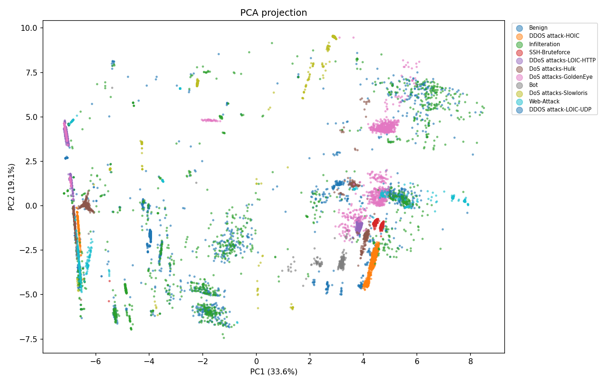

# Exploratory Data Analysis

Exploration of the **clean working data** (notebook `04_EDA`): all attack flows + 15% of the Benign flows,
after cleaning (notebook `03_Cleaning`), which gives about **2.97 million flows, 11 classes and 70 features**.

- Plots that need fewer points use a sample of at most 5,000 flows per class.
- Flow features are extremely skewed (most flows are tiny, a few are huge), so most plots use
  `log1p(x) = log(1 + x)`.

---

## 1. Class distribution

- **Benign** is still the largest class (≈ 1.64M flows), even after keeping only 15% of it.
- The attack classes range from ≈ 575,000 flows (DDoS LOIC-HTTP) down to **≈ 850 flows (Web-Attack)**:
  an imbalance of about **1,900 : 1** between the largest and the smallest class.
- By family, DDoS dominates (≈ 776,000 flows) and web attacks are tiny.

**Consequence:** accuracy would be misleading, so the main metric is **macro-F1**, and the models use
**class weights** and a cap on the largest classes.

---

## 2. Benign vs Attack distributions

- For every feature, **Benign and Attack overlap**: no single feature can separate them.
- Attacks show **sharp, narrow peaks** (e.g. `Flow Duration`, `Flow IAT Mean`, `Flow Pkts/s`): attack tools
  generate many nearly identical flows. Benign traffic is spread more evenly.
- Both types have a peak at 0 in `Flow Byts/s`, `Fwd Pkt Len Mean` and `Pkt Size Avg`: flows that carry no data.
- The small group of attack flows at `Tot Fwd Pkts` ≈ 12 (≈ 100,000+ packets per flow) is the UDP flood (LOIC-UDP).

**Consequence:** the classes must be separated by **combinations of features**, which is what tree
models do well.

---

## 3. Key features per class

Each attack has its own "signature":

- **Very narrow boxes** for Bot, DDoS HOIC, SSH-Bruteforce and DoS Hulk: their flows almost always have the
  same duration, packet count and rate.
- **DoS Slowloris and GoldenEye** have long durations and very low packet rates: they keep connections open
  slowly to exhaust the web server.
- **DDoS LOIC-UDP** reaches the maximum duration (120 s, the flow timeout of CICFlowMeter) with a huge number of packets.
- **Infilteration has almost the same boxes as Benign** for all 4 features, and Web-Attack is also very spread out.

**Consequence:** most attacks should be easy to detect, while **Infiltration will be confused with Benign**,
which is what the models showed later (notebook 08).

---

## 4. Destination ports

- **All DoS and DDoS attacks target port 80 (HTTP)**, and 82% of the web attacks too.
- **SSH-Bruteforce targets port 22 only**, and **Bot uses port 8080** (97%), its remote control channel.
- **Benign traffic is spread** over DNS (53), RDP (3389), HTTPS (443), HTTP (80) and other ports.
- **Infilteration has almost the same port mix as Benign**, so the port does not help for this class.

**Consequence:** the destination port is a strong signal for most attacks (it is the 3rd most important feature
of the Random Forest). Link with the network part: the web server (80) and SSH access (22) are the services the
bank network must protect first (ACLs, rate limiting).

---

## 5. Correlations between features

Several groups of features are **almost perfectly correlated**, because they are computed from the same packets:

- forward totals: `Tot Fwd Pkts`, `TotLen Fwd Pkts`, `Fwd Header Len`, `Subflow Fwd Pkts`, `Subflow Fwd Byts`, `Fwd Act Data Pkts`
- backward totals: `Tot Bwd Pkts`, `TotLen Bwd Pkts`, `Bwd Header Len`, `Subflow Bwd Pkts`, `Subflow Bwd Byts`
- timing: `Flow Duration` and `Fwd IAT Tot`; `Flow IAT Max`, `Fwd IAT Max` and `Idle Max`
- packet sizes: `Pkt Len Mean`, `Pkt Size Avg`, `Fwd Seg Size Avg`...
- flags: `Fwd PSH Flags` and `SYN Flag Cnt`; `RST Flag Cnt` and `ECE Flag Cnt`

**Consequence:** these features are redundant. Notebook 05 removes one feature of each pair with a correlation
above 0.99, which reduces **70 features to 49**.

---

## 6. Most informative features

- **Mutual information** measures how much a feature tells about the class, including non-linear relations.
- The top features are **timing** (`Fwd IAT Tot`, `Flow Duration`, `Flow IAT Max`) and **packet sizes**
  (`Pkt Len Max`, `Pkt Len Mean`).
- The top 20 scores are very close (1.47 to 1.64): the information is **spread over many features**, consistent
  with the correlations above. No single feature dominates.

---

## 7. PCA projection

- The first 2 components keep **53% of the variance** (33.6% + 19.1%).
- Most attacks form **compact, separate clusters** (DDoS HOIC, SSH-Bruteforce, Bot, DDoS LOIC-HTTP, DoS Hulk, GoldenEye).
- **Benign and Infilteration are scattered everywhere and overlap**, even in this simple linear projection.

---

## Summary

| Finding | Consequence for modeling |
|---|---|
| Strong class imbalance (≈ 1,900 : 1) | Macro-F1, class weights, cap on large classes |
| Very skewed features | `log1p` before scaling (for Logistic Regression and neural networks) |
| Many redundant features | Correlated features removed: 70 → 49 |
| Attacks have narrow, specific signatures (duration, rate, port) | Most attacks should be detected almost perfectly |
| Infiltration looks like Benign in every view | Expected main source of errors (confirmed in notebook 08) |