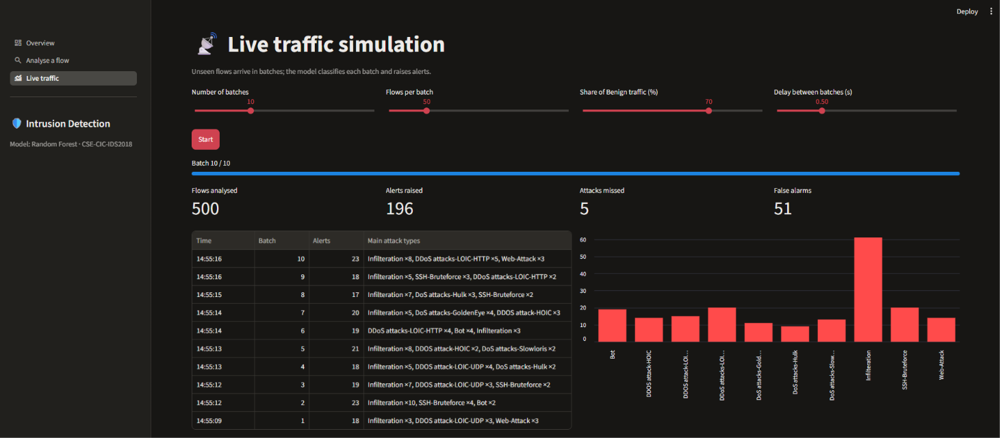

# Network Intrusion Detection — Attack Type Classification

A machine learning-based system for classifying network flows into **normal traffic or one of 10 attack types**, using the **CSE-CIC-IDS2018** dataset. Includes model evaluation and an interactive Streamlit application for traffic analysis.




## Dataset

**Source:** [CSE-CIC-IDS2018](https://www.unb.ca/cic/datasets/ids-2018.html) — Processed Traffic Data for ML Algorithms, obtained from the public AWS bucket `s3://cse-cic-ids2018/`.

**Original dataset:**
- 10 CSV files covering February 14 – March 2, 2018.
- 6.9 GB of data, approximately **16.2 million flows** and 78 features.
- Highly imbalanced, with **83% Benign traffic**.
- Data quality issues: 26% duplicate rows, missing and infinite values, repeated headers, negative durations and 8 constant columns.

**Data used:** All attack flows and a random 15% sample of Benign flows. After cleaning and filtering, **11 classes** were retained:

| Family | Classes |
|---|---|
| Normal | Benign |
| DDoS | DDOS attack-HOIC, DDoS attacks-LOIC-HTTP, DDOS attack-LOIC-UDP |
| DoS | DoS attacks-Hulk, DoS attacks-GoldenEye, DoS attacks-Slowloris |
| Brute force | SSH-Bruteforce |
| Botnet | Bot |
| Infiltration | Infilteration |
| Web attack | Web-Attack (Brute Force-Web, XSS and SQL Injection merged) |

**Excluded classes:** `FTP-BruteForce` and `DoS attacks-SlowHTTPTest` were dropped because approximately 99.9% of their rows were duplicates, leaving only around 55 unique flows per class.


## Pipeline

| Notebook | What it does |
|---|---|
| `01_download_and_merge` | Downloads the 10 CSV files from AWS and merges them into one Parquet file |
| `02_Data_Quality` | Measures the problems on the full 16.2M rows; creates the working sample |
| `03_Cleaning` | Removes header rows, `Timestamp`, constant columns, NaN/Inf, negative values, duplicates and contradictory rows; merges or drops small classes |
| `04_EDA` | Problem analysis and visual exploration (distributions, correlations, ports, PCA) |
| `05_Preprocessing` | Label encoding, stratified 80/20 split, removal of correlated features (49 kept), `log1p` + standard scaling |
| `06_ML_Models` | Logistic Regression, Decision Tree, Random Forest, XGBoost, LightGBM, soft voting, Optuna tuning |
| `07_Deep_Learning` | MLP and 1D-CNN (Keras) |
| `08_Evaluation` | Model comparison, confusion matrix, error analysis, SHAP |
| `09_Demo` | Predictions on unseen flows; exports the demo file used by the app |

**Class imbalance:** the training set is capped at 150,000 flows per class and the models use class
weights. The test set (593,221 flows) keeps the real distribution.

## Results

Main metric: **macro-F1** (every class counts equally; accuracy is misleading with 55% Benign in the test set).

| Model | Macro-F1 | Attacks detected | False alarms |
|---|---|---|---|
| Soft voting (RF + XGBoost + LightGBM) | 0.8915 | 98.3% | 19.4% |
| **Random Forest** | **0.8910** | 98.0% | **17.0%** |
| Decision Tree | 0.8888 | 97.8% | 20.7% |
| XGBoost | 0.8822 | 98.3% | 22.4% |
| LightGBM | 0.8574 | 98.5% | 21.3% |
| LightGBM tuned (Optuna) | 0.8566 | 98.4% | 21.6% |
| MLP | 0.8108 | 97.9% | 33.0% |
| 1D-CNN | 0.7973 | 97.2% | 31.7% |
| Logistic Regression | 0.7946 | 97.2% | 38.6% |

**Model picked: Random Forest.** It is the best single model, practically equal to soft voting (which needs
3 models), and it has the fewest false alarms.

**Key findings**
- Most attacks are detected almost perfectly (F1 ≥ 0.99 for DDoS, DoS, Bot and SSH brute force).
- **Almost all false alarms are Benign flows predicted as Infiltration.** Infiltration traffic comes from
  inside the network and looks like normal traffic; this class is also known to have labeling issues in the
  dataset.
- Optuna tuning did not improve the test score: the limit comes from the data, not the hyperparameters.

## Demo app

A Streamlit app with 3 pages:

- **Overview:** the project, the classes, the models and their scores, and why Random Forest was picked
- **Analyse a flow:** pick an unseen flow and see the prediction, its confidence, the suggested response
  and a SHAP explanation
- **Live traffic:** flows arrive in batches; the model raises alerts and counts missed attacks and false alarms

## Project structure

```bash
Network-Intrusion-Detection/
├── app.py                  # entry point of the demo app
├── app/                    # app pages and shared loading code
├── assets/
│   ├── figures/            # plots from the notebooks + demo screenshot
│   ├── models/             # ML/ (joblib), DL/ (keras), shared/ (encoder, feature list)
│   └── results/            # final_comparison.csv + per-model metrics
├── data/
│   └── demo_flows.parquet  # ~550 unseen test flows used by the app
├── notebooks/              # 01 → 09
├── requirements.txt
└── README.md
```

## How to run

**Demo app**
```bash
pip install -r requirements.txt
streamlit run app.py
```
Use the same scikit-learn version as the one used to train the model (see `requirements.txt`).

**Notebooks:** they run on Google Colab with Google Drive, in order from 01 to 09. The raw data (6.9 GB) is
not included in this repository: notebook 01 downloads it from the public AWS bucket.

## Limitations

- The traffic was generated in a lab network on AWS, not captured in a real bank.
- CSE-CIC-IDS2018 has known quality issues (duplicates, labeling errors, especially for Infiltration).
- The train/test split is random within the same capture days, which is optimistic compared to detecting new attacks.

